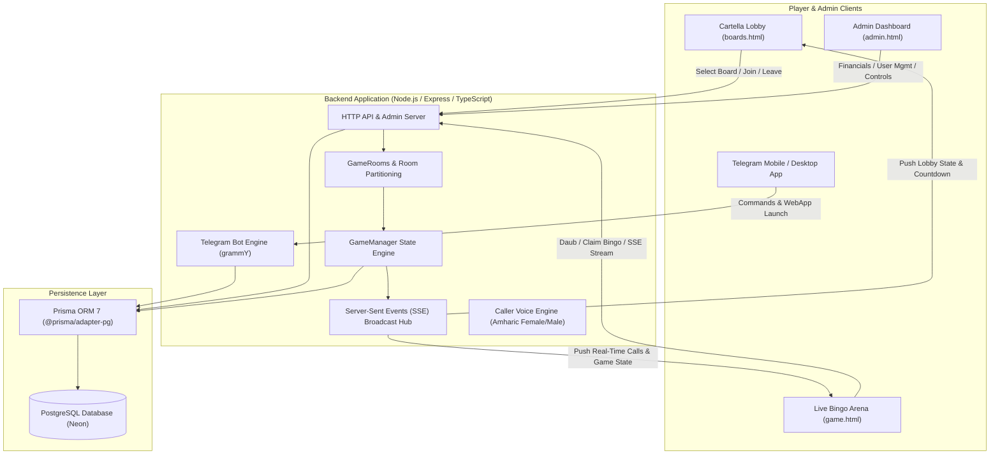
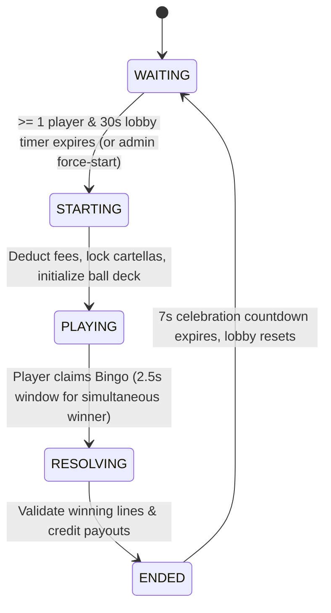

# Ethio Bingo — System Architecture, Mechanics & Rules Documentation

## 1. Executive Summary
**Ethio Bingo** (@PlayMyBingoBot) is a real-time, multi-player Ethiopian 75-Ball Bingo gaming platform integrated with Telegram WebApps. It provides fair, transparent, and responsive gameplay with synchronous number calling, instant winning verification, automated shared-jackpot payouts, and a comprehensive administrative dashboard for financial and player management.

---

## 2. High-Level System Architecture

### 2.1 Technology Stack
- **Backend Runtime**: Node.js 22 LTS with TypeScript (`tsx`).
- **Web & API Framework**: Express 5.
- **Telegram Bot Framework**: `grammY` framework (supporting WebApp integration, inline menus, contact verification).
- **ORM & Database**: Prisma ORM v7 with `@prisma/adapter-pg` driver adapter on PostgreSQL (Neon serverless cloud).
- **Real-Time Transport**: Server-Sent Events (SSE) with clockwork broadcast ticks (low latency, zero client polling overhead).
- **Frontend Architecture**: Mobile-responsive HTML5, CSS3 Glassmorphism, Vanilla JS WebApps (Telegram WebApp SDK ready).
- **Deployment & Hosting**: Docker containerized on Render.com (`https://habesha-bingo-17p0.onrender.com`).

---

## 3. Core Database Models

```mermaid
erDiagram
    User ||--o{ TransactionRequest : places
    User ||--o{ GameHistory : plays
    User ||--o{ User : "referred by"
    BankAccount ||--o{ TransactionRequest : receives
    HouseIncome {
        int id PK
        int playerCount
        decimal totalCollected
        decimal winnerPayout
        decimal houseProfit
        bigint winnerId
        bigint winner2Id
        int winnerCount
        datetime createdAt
    }
    User {
        bigint id PK
        string username
        string firstName
        string lastName
        string phone
        decimal balance
        decimal bonus
        boolean banned
        int gamesPlayed
        int wins
    }
    TransactionRequest {
        int id PK
        bigint userId FK
        string type
        decimal amount
        string status
        string phone
        string proofUrl
        string bankName
    }
    GameHistory {
        int id PK
        bigint userId FK
        decimal bet
        decimal payout
        string result
    }
```

1. **`User`**: Tracks player Telegram ID (`BigInt`), name, username, verified phone number, wallet balance, promotional bonus balance, referral lineage, and ban status.
2. **`TransactionRequest`**: Records manual deposits (with receipt screenshots) and withdrawals (bank/telebirr account) with statuses: `PENDING`, `APPROVED`, `REJECTED`.
3. **`HouseIncome`**: Permanent financial ledger for completed game rounds, storing player count, gross pot, 80% winner payouts, 20% house profit, and single or dual winner Telegram IDs.
4. **`GameHistory`**: Individual player round history (win/loss records and individual payouts).
5. **`BankAccount`**: Active banking and payment destinations configured by admin.

---

## 4. Game Lifecycle & Mechanics

The game is governed by the `GameManager` state machine partitioned into rooms based on entry bet fees (e.g., 10 Birr, 20 Birr, 50 Birr).

### 4.1 Room States

#### 1. `WAITING` (Lobby & Cartella Selection)
- Players open `boards.html` and view available boards numbered **1 to 400**.
- **Cartella Structure**: Standard 5×5 American Bingo ticket with columns:
  - **B**: 1–15
  - **I**: 16–30
  - **N**: 31–45 (Center cell is free: `0`)
  - **G**: 46–60
  - **O**: 61–75
- Taken boards are marked with red badges and locked in real time.
- Clicking a board shows an instant preview grid of its numbers.
- Once &ge; 1 player selects a board, an auto-start **30-second countdown** is broadcast to all clients.
- Players may leave the lobby anytime before start with full instant fee refund.

#### 2. `STARTING` (Initialization)
- Entry bet fees are deducted from the player's wallet balance (using deposit balance or promotional bonus).
- Cartellas are finalized and locked against changes.
- The 75-ball draw deck is shuffled.

#### 3. `PLAYING` (Active Calling & Daubing)
- Numbers are called at an exact, clockwork **4-second interval**.
- **Visual Feedback**:
  - Top capsule shows the currently called number in a bold `48x34px` badge.
  - A 4-second synchronized progress bar visualizes time until the next ball.
  - Audio pronunciation plays in either **Female** or **Male** Amharic caller voices.
- **Daubing**: Players tap matching numbers on their board. Tapping again un-daubs if clicked by mistake.

#### 4. The 15+ Candidate Simulation Algorithm
To protect game balance, fair distribution, and prevent excessive ties while ensuring natural gameplay:
- **Draws 1 to 14**: Purely randomized ball draws from the remaining pool.
- **Draws 15+**: The engine evaluates candidate balls before drawing. It simulates the impact of each remaining number across all active player cartellas and only selects candidate balls that produce **at most 2 winners** (&le; 2). This strictly prevents jackpot fragmentation across 3+ players while preserving true fairness.

#### 5. Winning Verification & Claiming
When a player achieves a winning pattern, they tap the **BINGO** button:
- **Valid Winning Patterns**:
  1. **Horizontal Line**: Any complete row of 5 marked numbers.
  2. **Vertical Line**: Any complete column of 5 marked numbers.
  3. **Diagonal Line**: Top-left to bottom-right OR top-right to bottom-left through the center.
  4. **Four Corners**: All 4 outer corner numbers marked.
- **False Bingo Penalty**:
  - If a player presses BINGO without a verified winning pattern, the engine rejects the claim and **permanently blocks that cartella from claiming for the remainder of the round**.
- **Simultaneous Winner Resolution**:
  - When the first valid claim arrives, a **2.5-second resolution window** begins.
  - Any other player who completes their winning pattern on the same ball can claim within this window.
  - The loop timer is stopped immediately so no extraneous balls are called after a valid win.

#### 6. Payout & House Income Split
- **Gross Pot**: Total player entry fees (e.g., 10 players × 10 Birr = 100 Birr).
- **Winner Payout (80%)**: 80 Birr.
  - **Single Winner**: Receives the entire 80 Birr credited to their wallet balance.
  - **Dual Winners (Ties)**: The 80 Birr jackpot is split equally (40 Birr each).
- **House Profit (20%)**: 20 Birr recorded in the `houseIncome` ledger table.

#### 7. `ENDED` (Winner Celebration)
- The winner modal overlays the game board, displaying:
  - Winner name, `@username`, and payout amount.
  - The winner's complete cartella with the winning line highlighted.
  - The exact ball that triggered the win highlighted in bold.
  - For dual winners, a "🤝 Shared Jackpot" badge with tabs to inspect both winning boards.
- **7-Second Countdown**: Counts down from **7 &rarr; 0** seconds before redirecting all players back to the cartella selection lobby (`boards.html`).

---

## 5. Official Rules & Regulations (የቢንጎ ጨዋታ ህጎች)

### 5.1 የአማርኛ መመሪያ (Amharic)

> 🎮 **Ethio Bingo — የቢንጎ ጨዋታ ህጎች**
>
> 🃏 **1. መጫወቻ ካርድ (Cartella Selection)**
> • ጨዋታውን ለመጀመር ከሚመጣልን ከ1 እስከ 400 የመጫወቻ ካርድ ውስጥ አንዱን ወይም የሚፈልጉትን እንመርጣለን።
> • የመጫወቻ ካርዱ ላይ በቀይ ቀለም የተመረጡ ቁጥሮች የሚያሳዩት መጫወቻ ካርድ በሌላ ተጫዋች ቀድሞ መመረጡን ነው።
> • የመጫወቻ ካርድ ስንነካው ከታች በኩል ካርድ ቁጥሩ የሚይዘዉን ሙሉ ቁጥሮች በቅድመ-ዕይታ ያሳየናል።
> • ወደ ጨዋታው ለመግባት የምንፈልገዉን ካርድ ከመረጥን ለምዝገባ የተሰጠው ሰኮንድ ዜሮ ሲሆን ቀጥታ ወደ ጨዋታ ያስገባናል።
>
> 🎲 **2. ጨዋታው ሲጀመር (Live Gameplay)**
> • ወደ ጨዋታው ስንገባ በመረጥነው የካርድ ቁጥር መሰረት የመጫወቻ ካርድ እናገኛለን።
> • ከላይ በቀኝ በኩል ጨዋታው ለመጀመር ያለዉን ቀሪ ሴኮንድ መቁጠር ይጀምራል።
> • ጨዋታው ሲጀምር የተለያዪ ቁጥሮች ከ1 እስከ 75 በየ 4 ሴኮንዱ መጥራት ይጀምራል።
> • የሚጠራው ቁጥር የኛ መጫወቻ ካርድ ዉስጥ ካለ የተጠራዉን ቁጥር ክሊክ በማረግ መምረጥ እንችላለን።
> • የመረጥነዉን ቁጥር ማጥፋት ከፈለግን መልሰን እራሱን ቁጥር ክሊክ በማረግ ማጥፋት እንችላለን።
>
> 🏆 **3. አሸናፊ እና ደራሽ (Winning & Payouts)**
> • ቁጥሮቹ ሲጠሩ ከመጫወቻ ካርዳችን ላይ እየመረጥን:
>   - **ወደ ጎን** (አግድም 5 መስመር)፣
>   - **ወደ ታች** (ቁልቁል 5 መስመር)፣
>   - **ወደ ሁለቱም አግዳሚ** (የመስቀለኛ ዲያጎናል መስመር)፣ ወይም
>   - **አራቱን ማዕዘናት** (4 Corners)
>   ከሞላን ወዲያውኑ ከታች በኩል **BINGO** የሚለዉን በመንካት ማሸነፍ እንችላለን።
> • **የሀሰት ቢንጎ ማስጠንቀቂያ**: መስመሮቹ ወይም አራቱ ማዕዘናት ሳይጠሩ BINGO የሚለዉን ክሊክ ካደረግን ካርዱ ውድቅ ሆኖ ለዛ ዙር ከጨዋታው ይታገዳል!
> • **እኩል ሲያሸንፉ**: ሁለት ተጫዋቾች እኩል ቢያሸንፉ ደራሹ (80%) ለቁጥራቸው እኩል ይካፈላል።
> • አሸናፊው ከታወቀ በኋላ የ7 ሴኮንድ ቆጠራ ካለቀ በኋላ ቀጥታ ወደ ካርቴላ መምረጫው ይመለሳል።

### 5.2 English Rules & Guidelines

1. **Ticket Selection**: Choose an open ticket numbered 1–400. Red tickets are taken.
2. **Calling**: Balls (1–75) are called every 4 seconds with Amharic voice announcements.
3. **Daubing**: Mark numbers as they are called.
4. **Winning Patterns**:
   - 5 in a row horizontally
   - 5 in a row vertically
   - 5 in a row diagonally
   - 4 outer corners
5. **Jackpot Distribution**:
   - 80% credited to the winner (or split 50/50 in case of a tie).
   - 20% allocated as House Income.
6. **False Bingo**: Claiming BINGO without a valid pattern permanently disables your board for that round.
7. **Round Reset**: A 7-second countdown displays the winning board before lobby re-opens.

---

## 6. Financial Operations & Administration

- **Deposits**: Minimum 10 Birr via CBE or Telebirr. Users upload screenshot receipt proof. Approvals can be done individually or in batch.
- **Withdrawals**: Players enter account name, account number, and bank. Admin reviews wallet balance and approves or rejects with reason.
- **Period Filter**: Admin dashboard aggregates deposits, withdrawals, house profits, and rounds across Today, Yesterday, 7 Days, Month, or All Time.
- **User Management**:
  - Live search by Name, Username, Phone, or ID.
  - Edit player wallet balance and bonus funds.
  - Ban / unban accounts for malicious behavior.
  - Safe deletion with cascading database cleanup.
